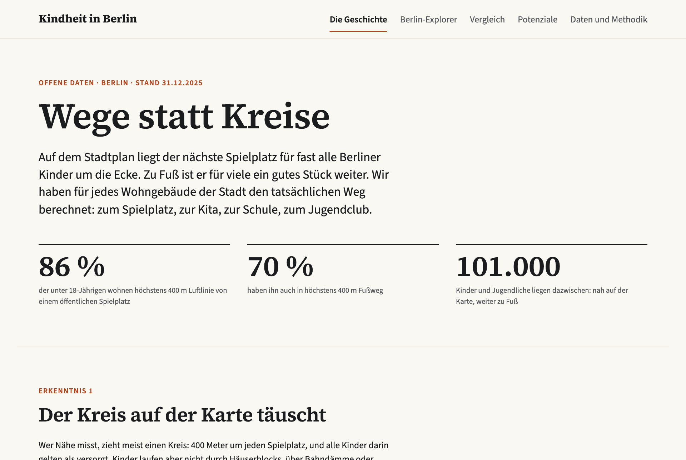
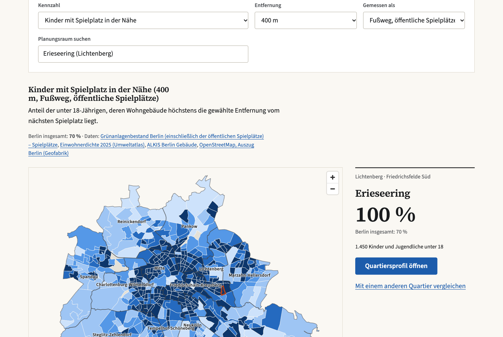
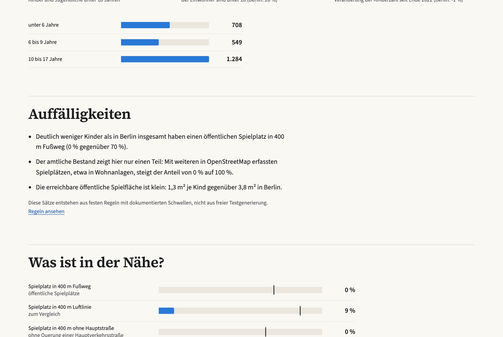
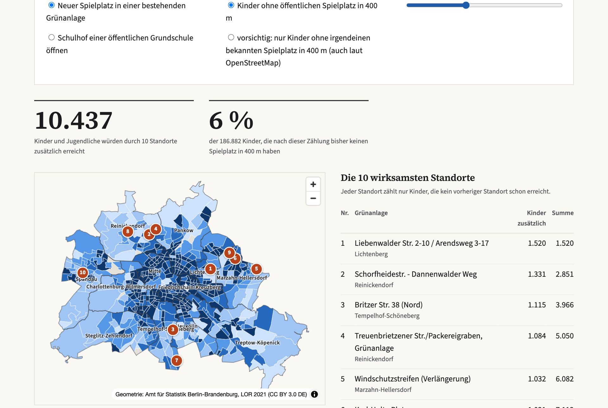

# Kindheit in Berlin – Wege statt Kreise

Wie weit ist es für Berlins Kinder wirklich zum nächsten Spielplatz, zur Kita, zur Schule, zum Jugendclub?
Diese Webanwendung rechnet für jedes Wohngebäude der Stadt den tatsächlichen Fußweg aus, statt Kreise auf eine Karte
zu zeichnen, und zeigt, wo zusätzliche Angebote besonders viele Kinder erreichen würden.

Beitrag zum [Berliner Open-Data-Ideenwettbewerb 2026/2027](https://www.berlin.de/moderne-verwaltung/e-government/open-data-wettbewerb-1730431.php).

**Anwendung:** noch nicht veröffentlicht (nach dem ersten Deployment hier die Adresse der GitHub-Pages-Seite eintragen)

| | |
|---|---|
|  |  |
|  |  |

## Was die Daten zeigen

- 86 % der 627.759 unter 18-Jährigen wohnen höchstens 400 m Luftlinie von einem öffentlichen Spielplatz, aber nur
  70 % höchstens 400 m Fußweg.
- Nur ein Zehntel dieser Lücke geht auf Bahntrassen, Gewässer und Autobahnen zurück; der Rest sind gewöhnliche Umwege.
- Kinder in Quartieren mit hohem sozialen Status haben die weitesten Wege, in Quartieren mit sehr niedrigem Status
  teilen sich mehr Kinder dieselbe Fläche.
- Die Kinderzahl wächst am Stadtrand, wo die Wege länger sind.
- Der amtliche Spielplatzbestand enthält die Plätze der Wohnungsunternehmen nicht; in Großsiedlungen ändert das das
  Bild grundlegend.

Alle Erkenntnisse mit Zahlen und Fundstellen: [docs/FINDINGS.md](docs/FINDINGS.md).

## Die Anwendung

| Seite | Inhalt |
|---|---|
| Die Geschichte | Sechs Erkenntnisse mit Diagrammen, jede mit Datentabelle |
| Berlin-Explorer | 18 Kennzahlen für 542 Planungsräume als Karte und sortierbare Tabelle; Entfernung und Messweise wählbar; jede Ansicht als Link teilbar |
| Quartiersprofil | Kinder nach Alter, Wege und Angebote im Vergleich zu Berlin, regelbasierte Hinweise, Umfeld, ähnliche Quartiere |
| Vergleich | Zwei Quartiere nebeneinander, Vorschläge für ähnliche Quartiere |
| Potenziale | Modellrechnung: die wirksamsten Standorte für neue Spielplätze in Grünanlagen oder geöffnete Schulhöfe |
| Daten und Methodik | Rechenweg, Kennzahlen, Regeln, Grenzen, Quellen, Downloads |

Die Anwendung ist vollständig statisch: kein Backend, keine Kartenkacheln oder Schriften von Dritten, keine Cookies.

## Lokal entwickeln

Voraussetzung: Node.js 22.18 oder neuer.

```bash
npm install
npm run dev          # Entwicklungsserver
npm run build        # Typprüfung und Produktions-Build nach dist/
```

Die aufbereiteten Daten liegen im Repository (`public/data`); für die Webanwendung muss die Datenpipeline nicht laufen.

## Tests

```bash
npm run type-check                 # TypeScript strict
npm run lint                       # ESLint
npm test                           # 37 Tests: Fachlogik und Konsistenz der veröffentlichten Daten
npx playwright install chromium    # einmalig
npm run build && npm run test:e2e  # 17 Tests in Desktop- und Mobilgröße: Nutzungswege, WCAG 2.2 AA (axe-core), Betrieb im Unterpfad
.venv/bin/python -m pytest tests/pipeline -q   # 12 Tests der Rechenverfahren
```

## Datenaufbereitung nachrechnen

Voraussetzung: Python 3.13 (damit getestet), rund 1 GB freier Speicher.

```bash
python3 -m venv .venv && .venv/bin/pip install -r pipeline/requirements.txt
.venv/bin/python -m pipeline.download                        # Rohdaten nach data/raw (gecacht, rund 380 MB)
.venv/bin/python -m pipeline.walk_network                    # Fußwegenetz aus OpenStreetMap
.venv/bin/python -m pipeline.osm_features                    # weitere Spielplätze, Bibliotheken, Barrieren
.venv/bin/python -m analysis.01_home_accessibility           # Wohnstandorte und Fußwege
.venv/bin/python -m analysis.02_planning_area_indicators     # Kennzahlen je Planungsraum
.venv/bin/python -m analysis.03_findings                     # Erkenntnisse, Falllisten, Szenarien
.venv/bin/python -m pipeline.export_frontend                 # public/data, validiert; docs/DATA_SOURCES.md
.venv/bin/python -m analysis.04_figures                      # Grafiken unter docs/figures
```

Nach dem Download dauert die gesamte Rechnung unter zwei Minuten. `pipeline.download --force` lädt alles neu. Der
OpenStreetMap-Auszug ist tagesaktuell; mit neuen Daten können sich Werte leicht ändern, die Tests melden
Abweichungen der Kernzahlen.

## Deployment

`.github/workflows/ci.yml` prüft, testet und baut bei jedem Push und veröffentlicht den Stand von `main` auf GitHub
Pages. Einmalig einzurichten:

1. Öffentliches Repository anlegen und pushen.
2. In den Repository-Einstellungen unter „Pages“ als Quelle „GitHub Actions“ wählen.
3. Die Adresse des Repositories in `src/config.ts` eintragen.

`.github/workflows/update-data.yml` aktualisiert auf Knopfdruck die Daten und öffnet einen Pull Request. Schlägt ein
Download, die Validierung oder ein Test fehl, bleibt der veröffentlichte Stand unverändert.

## Dokumentation

| Dokument | Inhalt |
|---|---|
| [docs/FINDINGS.md](docs/FINDINGS.md) | Erkenntnisse, widerlegte Erwartungen, offene Hypothesen |
| [docs/METHODOLOGY.md](docs/METHODOLOGY.md) | Rechenwege, Annahmen, Grenzen |
| [docs/DATA_SOURCES.md](docs/DATA_SOURCES.md) | Quellen, Lizenzen, Datenstände, verwendete Attribute (erzeugt) |
| [docs/DATA_QUALITY.md](docs/DATA_QUALITY.md) | Datenqualität, fehlende Daten, Wünsche an die Datenhalter |
| [docs/ARCHITECTURE.md](docs/ARCHITECTURE.md) | Aufbau und begründete Entscheidungen |
| [docs/AI_USAGE.md](docs/AI_USAGE.md) | Einsatz generativer KI |
| [docs/COMPETITION.md](docs/COMPETITION.md) | Wettbewerbsanforderungen, Formularfelder, Checkliste |
| [docs/ANALYSIS_REPORT.md](docs/ANALYSIS_REPORT.md) | Bericht der Recherche- und Analysephase |
| [CLAUDE.md](CLAUDE.md) | Leitlinien für die KI-gestützte Weiterentwicklung |

## Lizenzen

- Quellcode: [MIT](LICENSE)
- Texte und Grafiken: [CC BY 4.0](LICENSE-CONTENT.md)
- Daten Dritter und abgeleitete Daten: siehe [THIRD_PARTY_NOTICES.md](THIRD_PARTY_NOTICES.md)

Daten: Land Berlin (dl-de/zero-2.0), Amt für Statistik Berlin-Brandenburg (CC BY 3.0 DE), Polizei Berlin (CC BY 4.0),
Statistische Ämter des Bundes und der Länder (dl-de/by-2.0), © OpenStreetMap-Mitwirkende (ODbL).
