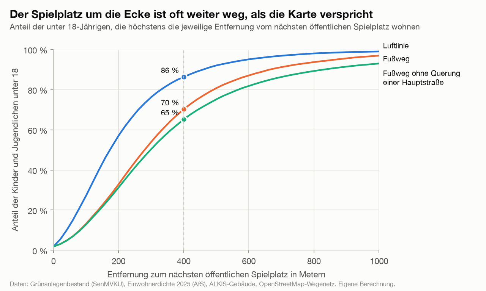
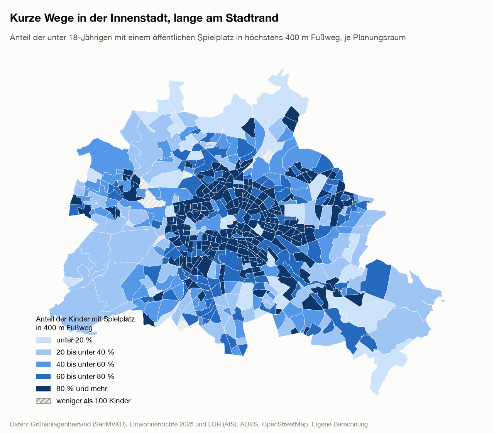
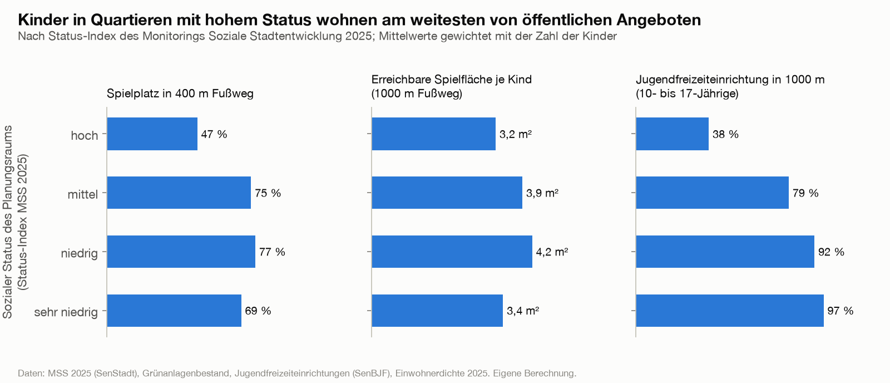
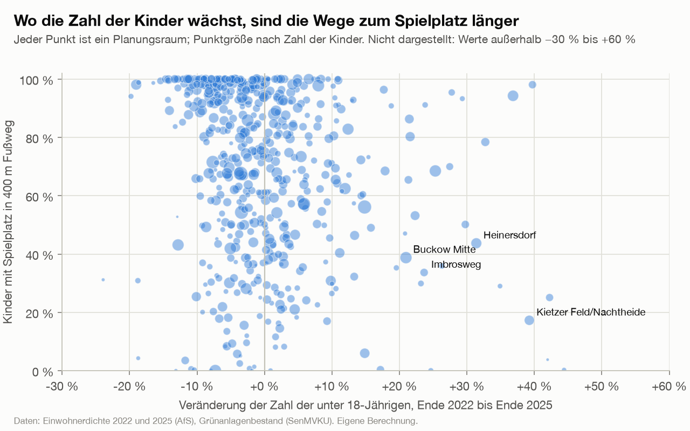
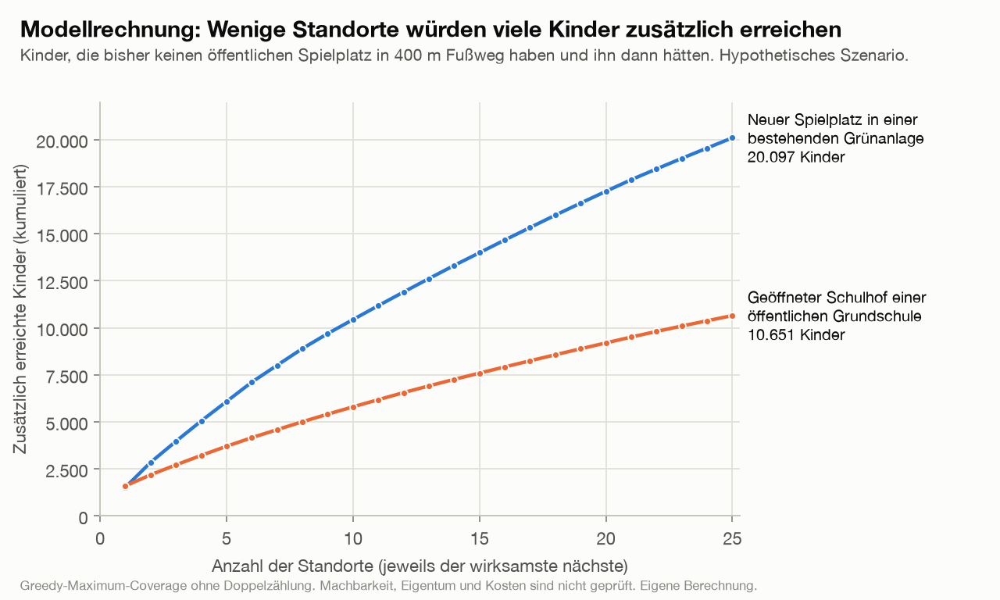
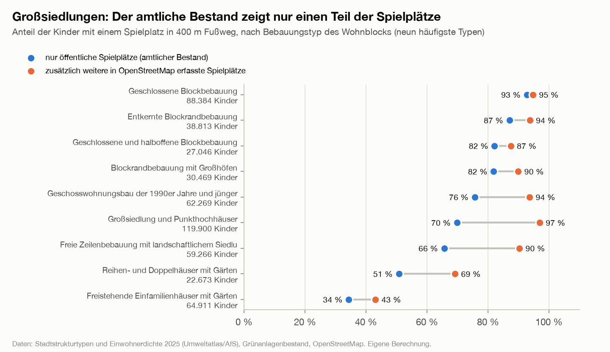

# Analysebericht Phase 1 und 2 – Kindheit in Berlin

> Dieser Bericht dokumentiert Recherche, explorative Analyse und das daraus abgeleitete Konzept. Die Anwendung ist
> inzwischen umgesetzt; aktuelle Zahlen und Rechenwege stehen in [FINDINGS.md](FINDINGS.md) und
> [METHODOLOGY.md](METHODOLOGY.md).

Stand: 24.11.2026 · Bevölkerungsstand der Auswertung: 31.12.2025 · alle Zahlen stammen aus
`data/processed/findings.json` und sind mit den Skripten in `pipeline/` und `analysis/` reproduzierbar
(siehe Abschnitt 13).

## 1. Kurzfassung

Berlin hat 627.759 Einwohnerinnen und Einwohner unter 18 Jahren. Für jedes ihrer Wohngebäude wurde der
tatsächliche Fußweg zu Spielplätzen, Jugendfreizeiteinrichtungen, Kitas, Grundschulen, Grünanlagen,
Sportanlagen und Bibliotheken berechnet. Die fünf wichtigsten Ergebnisse:

1. **Der Fußweg ist deutlich länger als die Karte verspricht.** 86 % der Kinder wohnen höchstens 400 m
   Luftlinie von einem öffentlichen Spielplatz, aber nur 70 % höchstens 400 m Fußweg. Für rund 101.000
   Kinder liegt der Spielplatz nur auf der Karte in der Nähe. Der mittlere Fußweg ist 280 m, die mittlere
   Luftlinie 173 m.
2. **Es sind nicht die großen Barrieren.** Nur bei rund 10 % dieser Kinder liegt eine Bahntrasse, eine
   Autobahn oder ein Gewässer auf der direkten Linie. 90 % der Differenz entstehen durch gewöhnliche
   Umwege im Straßen- und Wegenetz. Hauptstraßen kommen dazu: 31.300 Kinder erreichen ihren Spielplatz in
   400 m nur über eine Hauptstraße, 6.600 davon nur über eine Querung ohne Ampel oder Zebrastreifen.
3. **Der soziale Zusammenhang läuft anders als erwartet.** Kinder in Planungsräumen mit hohem sozialen
   Status wohnen am weitesten von öffentlichen Angeboten entfernt (47 % mit Spielplatz in 400 m, 38 % der
   10- bis 17-Jährigen mit Jugendfreizeiteinrichtung in 1000 m). In Planungsräumen mit sehr niedrigem
   Status sind die Wege kurz (69 % bzw. 97 %), aber die erreichbare Spielfläche je Kind ist kleiner als in
   Räumen mit mittlerem und niedrigem Status (3,4 m² gegenüber 3,9 und 4,2 m²). Treiber ist die Bebauungsdichte.
4. **Die Kinderzahl wächst dort, wo die Wege länger sind.** Berlinweit sank die Zahl der unter
   18-Jährigen von Ende 2022 bis Ende 2025 um 0,8 %: innere Stadt −5,0 %, äußere Stadt +1,6 %. In den
   61 Planungsräumen mit mindestens 10 % Zuwachs (zusammen +10.900 Kinder) haben 62 % der Kinder einen
   Spielplatz in 400 m, in schrumpfenden Räumen 78 %.
5. **Der amtliche Spielplatzbestand zeigt in Großsiedlungen nur einen Teil.** Nach amtlichem Bestand
   haben 70 % der 119.900 Kinder in Großsiedlungen einen Spielplatz in 400 m. Zählt man die weiteren in
   OpenStreetMap erfassten, nicht als privat markierten Spielplätze mit, sind es 97 %. Berlinweit steigt
   der Wert von 70 % auf 84 %. Jede Aussage über „Unterversorgung“ hängt an dieser Datenlücke.

Daraus folgt das Anwendungskonzept in Abschnitt 11: eine geführte Datenstory über *Wege statt Kreise*,
ein Explorer auf Planungsraumebene und ein Potenzial-Explorer mit zwei durchgerechneten Szenarien.

## 2. Wettbewerbsrahmen

Die Teilnahmebedingungen und das Einreichungsformular wurden am 24.11.2026 erneut geprüft. Alle
Anforderungen, die Formularfelder und die Einreichungs-Checkliste stehen in
[COMPETITION.md](COMPETITION.md). Für die Konzeption wichtig:

- Einsendeschluss 15.01.2027, 23:59 Uhr (Eingang der E-Mail), höchstens zwei Beiträge je Person oder Team.
- Kurzbeschreibung höchstens 1.500 Zeichen inklusive Leerzeichen.
- Jede verwendete Datenquelle ist mit Link anzugeben, KI-Einsatz mit Werkzeug und Zweck.
- Das Datensatz-Feedback ist Pflicht, fließt aber nicht in die Bewertung ein.
- Barrierearmut ist eine Bitte, keine Pflicht, zählt aber im Kriterium Verständlichkeit (20 %).
- Zu klären: Die Bedingungen enthalten in Ziffer 3.4 ein Datum in eckigen Klammern („[01.10.2026]“) für
  den frühesten Entstehungszeitpunkt. Das Projekt beginnt am 24.11.2026 und ist davon nicht betroffen.

## 3. Bestehende Angebote und Abgrenzung

| Angebot | Was es zeigt | Was fehlt |
|---|---|---|
| Amtliche Spielplatzversorgung (SenMVKU) | Nutzbare Spielfläche je Einwohner gegen den Richtwert 1 m² (§ 4 Kinderspielplatzgesetz), berlinweit rund 60 % | Bezug auf alle Einwohner statt auf Kinder, keine Wege, Ergebnisse nicht als offene Daten gefunden |
| Bezirkliche Spielplatzentwicklungspläne | Defizite je Versorgungsbereich, Prioritäten | je Bezirk unterschiedlich, überwiegend PDF |
| Amt für Statistik, Meldung „Spielplätze in Berlin“ (2024) | m² je Einwohner je Planungsraum | Verwaltungsgrenzen als Einzugsbereich |
| Berliner Spielplatzkarte (OSM, ehrenamtlich, seit 2024) | Standorte und Ausstattung aus OpenStreetMap | keine Bevölkerung, keine Versorgungsaussage |
| „Leben in Berlin“ (Amt für Statistik) | Familien-Dashboard mit Kommunalstatistik | keine Erreichbarkeit |
| Umweltgerechtigkeitsatlas | Mehrfachbelastung je Planungsraum | kein Kinderbezug |

In der Recherche wurde keine Anwendung gefunden, die Kinder gebäudegenau verortet, reale Fußwege rechnet,
Hauptstraßenquerungen berücksichtigt und Szenarien bewertet. Das ist der eigenständige Beitrag.

## 4. Dateninventar

Alle Quellen sind in `pipeline/sources.py` registriert; Abrufdatum und Umfang stehen nach dem Download in
`data/raw/manifest.json`. Abruf aller Daten: 24.11.2026.

| Datensatz | Anbieter | Lizenz | Stand | Auflösung | Verwendung | Eignung |
|---|---|---|---|---|---|---|
| LOR-Planungsräume 2021 (WFS) | AfS | CC BY 3.0 DE | 2021 | 542 Flächen | Raumbezug | sehr gut |
| Einwohnerdichte 2025 (Umweltatlas, WFS) | AfS | CC BY 3.0 DE | 31.12.2025 | 26.613 Blöcke, 15.092 bewohnt | Kinder nach Alter je Block, Bebauungstyp | sehr gut, Kern der Analyse |
| Einwohnerdichte 2022 (WFS) | AfS | CC BY 3.0 DE | 31.12.2022 | Blöcke | Veränderung der Kinderzahl | gut (erstes Jahr mit Altersgruppen) |
| ALKIS Gebäude (WFS) | SenStadt | dl-de/zero-2.0 | 11/2026 | 309.025 Wohngebäude | Wohnorte innerhalb der Blöcke | sehr gut |
| Grünanlagenbestand inkl. Spielplätze (WFS) | SenMVKU | dl-de/zero-2.0 | 04/2026 | 1.886 Spielplatz-, 2.563 Grünflächen | Spielfläche, Erreichbarkeit, Szenario | gut, Lücken siehe 5 |
| Jugendfreizeiteinrichtungen (WFS) | SenBJF | dl-de/zero-2.0 | 12/2025 | 418 Punkte mit Platzzahl | Angebote für Jugendliche | gut |
| Kindertagesstätten (WFS) | SenBJF | dl-de/zero-2.0 | 12/2025 | 2.905 Punkte mit Platzzahl | Kita-Plätze je Kind | gut |
| Schulen (WFS) | SenStadt/SenBJF | dl-de/zero-2.0 | Schuljahr 2026/27 | 929 Punkte | Schulwege, Schulhof-Szenario | gut, keine Kapazitäten |
| Standorte öffentlicher Sportanlagen (WFS) | SenInnSport | dl-de/zero-2.0 | 12/2025 | 1.085 Punkte | Bewegungsangebote | mittel (Zugänglichkeit unbekannt) |
| Monitoring Soziale Stadtentwicklung 2025 (WFS) | SenStadt | dl-de/zero-2.0 | 31.12.2024 | 542 Planungsräume | Kinderarmut, Status-Index, Wohnfläche | sehr gut |
| Umweltgerechtigkeit 2023/2024 (WFS) | SenMVKU | dl-de/zero-2.0 | 2023/24 | 542 Planungsräume | Lärm, Luft, Hitze, Grün | gut, nur Klassen |
| Verkehrsmengen DTVw 2023 (WFS) | SenMVKU | dl-de/zero-2.0 | 2023 | 8.337 Abschnitte | geprüft, noch nicht verwendet | gut |
| Tempolimits (WFS) | SenMVKU | dl-de/zero-2.0 | 05/2025 | 29.800 Abschnitte | geprüft, noch nicht verwendet | gut |
| Unfallatlas 2018–2024 | Statistische Ämter | dl-de/by-2.0 | 2018–2024 | 87.266 Unfälle in Berlin | Unfälle im Schulumfeld | gut, ohne Alter |
| Verkehrsunfälle 2025 | Polizei Berlin | CC BY 4.0 | 2025 | 270.740 Beteiligte | Kontextzahl | eingeschränkt (keine Koordinaten) |
| Statistischer Bericht A I 16 – hj 1/26 | AfS | CC BY 3.0 DE | 30.06.2026 | Planungsräume | einmalige Plausibilitätsprüfung, nicht Teil der Pipeline | gut |
| OpenStreetMap (Geofabrik-Auszug) | OSM-Mitwirkende | ODbL 1.0 | 11/2026 | 1,14 Mio. Knoten, 23.594 km Wege | Fußwegenetz, Querungen, Spielplätze, Bibliotheken, Barrieren | sehr gut |

Geprüft und zurückgestellt: Einschulbereiche (erst für die Schulweg-Ansicht nötig), Klimaanalyse 2022,
Versiegelung, Baumbestand (nur Grün-Berlin-Liegenschaften offen), Bevölkerungsprognose (nicht im Portal
gefunden), Zensus-Gitter (durch Blockdaten mit Altersgruppen überflüssig), Öffentliche Toiletten,
Landesgrundvermögen (interessant für spätere Flächenszenarien).

## 5. Datenqualität und Verknüpfbarkeit

Geprüft mit `analysis/00_inspect_raw.py`: Alle geladenen Geometrie-Layer liegen in EPSG:25833 vor, ohne leere oder
ungültige Geometrien; die Zahl der geladenen Objekte stimmt mit der vom Server gemeldeten überein.

**Bestätigte Plausibilität**

- Blocksumme der Einwohner: 3.913.505, Summe der Altersgruppen je Block exakt gleich der Blocksumme.
- Netto-Spielfläche 236,1 ha, das sind 0,60 m² je Einwohner. Die amtliche Angabe „rund 60 %“ des
  Richtwerts wird damit reproduziert.
- Kinderarmut (MSS, S4) gewichtet 22,5 %; der Bericht nennt 23,3 % für Berlin.
- Unfallatlas: 87.266 Unfälle mit Personenschaden in sieben Jahren, rund 12.500 je Jahr.

**Auffälligkeiten (Grundlage des Pflicht-Feedbacks)**

- **Einwohnerregister-CSV:** Die auf daten.berlin.de verlinkten Dateien
  (`…/opendata/EWR_L21_202512E_Matrix.csv` und ältere) liefern statt der Datei die Startseite des Amts
  mit HTTP 200. Die Daten sind nur noch im XLSX-Bericht mit mehrzeiligen Köpfen verfügbar.
- **Spielplätze:** 59 % ohne Baujahr (1.119 von 1.886), 73 % ohne Sanierungsjahr (1.377), 40 mit
  Netto-Spielfläche 0, 82 ohne Widmungsstatus. Kein einziges Attribut zu Ausstattung, Altersgruppe oder
  Barrierefreiheit. Spielplätze auf Flächen von Wohnungsunternehmen fehlen vollständig.
- **Blockdaten:** Altersgruppen erst ab 2022; kleine Werte sind zur Geheimhaltung gerundet (Vielfache von 3).
- **Jugendfreizeiteinrichtungen:** Zielgruppen-Merkmal nur bei 78 von 418 gesetzt, 23 identische Koordinaten.
- **Sportanlagen:** 508 von 1.085 ohne Flächenangabe, keine Angabe zur freien Zugänglichkeit; 745 liegen
  auf Schulgelände.
- **Kitas:** Nur genehmigte Plätze, keine belegten oder freien; 22 ohne Platzzahl; 32 doppelte Koordinaten.
- **Polizei-Unfalldaten:** Altersgruppe der Beteiligten vorhanden, aber keine Koordinaten; Dateikodierung
  Latin-1 ohne Angabe. Der Unfallatlas hat Koordinaten, aber kein Alter. Kinderunfälle lassen sich deshalb
  nicht kleinräumig auswerten.
- **MSS-WFS:** Attribute sind nur als Kürzel (`s4`, `ki_15`) benannt, `DescribeFeatureType` antwortet mit
  HTTP 400; die Bedeutung steht nur im PDF der Indikatorenblätter. Fehlwerte sind als −9999 kodiert.
- **Umweltgerechtigkeit:** Nur Klassen (gering/mittel/hoch), keine Messwerte; zwei Planungsräume ohne Wert.
- **Barrierefreiheit:** Amtlich keine Daten. In OpenStreetMap tragen 784 von 5.544 Spielplätzen (14 %)
  überhaupt eine Rollstuhl-Angabe, 418 davon „ja“. Fehlende Angaben werden nicht als „nicht barrierefrei“ gewertet.

## 6. Methodik in Kürze

1. **Wohnorte.** Die Einwohner jedes Blocks (mit Altersgruppen 0–5, 6–9, 10–17) werden proportional zur
   Geschossfläche auf die Wohngebäude des Blocks verteilt (ALKIS-Funktion Wohnen, Grundfläche × Zahl der
   oberirdischen Geschosse; ohne Senioren- und Studierendenwohnheime). 611 Blöcke ohne Wohngebäude
   (6.047 Kinder) erhalten einen Punkt im Block. Ergebnis: 166.695 Wohnstandorte.
2. **Fußwegenetz.** Aus OpenStreetMap, alle für Fußgänger nutzbaren Wege, nur die größte zusammenhängende
   Komponente (97,2 % der Knoten). Kantenlänge planar in EPSG:25833.
3. **Zugänge.** Flächen (Spielplätze, Grünanlagen) werden an allen Netzknoten im Umkreis von 15 m
   betreten, Punkte am nächsten Knoten. Die Luftlinie wird zum Vergleich um dieselben 15 m gekürzt.
4. **Hauptstraßen.** Knoten auf Straßen der OSM-Klassen primary, secondary und trunk gelten als
   Hauptstraßenkontakt. Zwei Varianten: ganz ohne Querung, und nur über Querungen mit Ampel oder Markierung.
5. **Spielfläche je Kind.** Zweistufiges Einzugsbereichsverfahren (2SFCA): Die Netto-Spielfläche jedes
   Platzes wird durch alle Kinder im Einzugsbereich geteilt, jedes Kind summiert die Anteile der Plätze,
   die es erreicht. Verwaltungsgrenzen spielen keine Rolle. Eine Erhaltungsprüfung läuft bei jeder Rechnung mit.
6. **Schwellen.** 200 m für unter 6-Jährige, 400 m als Standard, 1000 m für ältere Kinder und Jugendliche
   (angelehnt an DIN 18034). Alle Kurven sind für 200 bis 1000 m gerechnet.
7. **Aggregation.** Planungsraumwerte sind mit der Zahl der Kinder gewichtet. Anteile werden nur für
   Planungsräume mit mindestens 100 Kindern ausgewiesen (535 von 542).

## 7. Getestete Hypothesen

| Nr. | Frage | Ergebnis | Urteil |
|---|---|---|---|
| 1 | Wo leben viele Kinder je Spielfläche? | Berlinweit 3,76 m² je Kind. 30 % der Kinder erreichen in 400 m keinen öffentlichen Spielplatz, 37 % weniger als 1 m² je Kind. Bezirke von 2,7 m² (Marzahn-Hellersdorf) bis 4,5 m² (Friedrichshain-Kreuzberg) bei 1000 m. | bestätigt |
| 2 | Luftlinie gegen Fußweg | 86 % gegen 70 % bei 400 m, 57 % gegen 33 % bei 200 m. Mittlerer Umwegfaktor 1,45; für 27.600 Kinder mindestens das Dreifache. | bestätigt |
| 3 | Nominell versorgt, durch Barrieren abgeschnitten? | Bahn 7 %, Gewässer 2 %, Autobahn 1 % der Betroffenen. Nur 2.100 Kinder haben trotz 400 m Luftlinie mehr als 800 m Fußweg. | überwiegend widerlegt |
| 4 | Unterschiede bei ähnlichen Quartieren | Deutlich, siehe Abschnitt 8. Faktor 2 bis 5 bei gleicher Dichte, Kinderzahl und Kinderarmut. | bestätigt |
| 5 | Treffen wenig Spielfläche und hohe Umweltbelastung zusammen? | Nein. Hoch belastete Räume (drei- oder vierfach) haben 86 % mit Spielplatz in 400 m, unbelastete 57 %. Wenig Spielfläche: 19 % gegen 26 % der Räume. | widerlegt, mit Ausnahmen |
| 6 | Wachsende Kinderzahl bei wenig Infrastruktur | 61 Planungsräume mit +10 % und mehr; dort 62 % gegen 78 % mit Spielplatz in 400 m und 3,2 gegen 3,8 m² je Kind. | bestätigt |
| 7 | Jüngere gegen Ältere | 77 % der unter 6-Jährigen haben eine Kita in 400 m, 33 % einen Spielplatz in 200 m. 76 % der 10- bis 17-Jährigen haben eine Jugendfreizeiteinrichtung in 1000 m; 66.200 nicht, 11.900 auch nicht in 2000 m. | bestätigt |
| 8 | Soziale Lage und kostenlose Angebote | Wege sind bei niedrigem Status kürzer, nicht länger. Bei sehr niedrigem Status weniger Spielfläche je Kind und weniger Kita-Plätze (0,86 gegen 0,93 je Kind unter 6). | Erwartung widerlegt, differenziertes Bild |
| 9 | Wo helfen Querungen? | 6.600 Kinder erreichen den Spielplatz in 400 m nur über eine ungesicherte Hauptstraßenquerung. Lokalisierung einzelner Querungen folgt in Phase 4. | Ansatz tragfähig |
| 10 | Flächen für zusätzliche Angebote | 994 öffentliche Grünanlagen ab 2.000 m² ohne Spielplatz. Die 25 wirksamsten würden 20.100 Kinder zusätzlich erreichen, konservativ gerechnet 9.800. | bestätigt |
| 11 | Kleine Änderung, große Wirkung | Ein einzelner Standort erreicht bis zu 1.500 Kinder (konservativ 640). Schulhöfe wirken gut halb so stark wie Grünanlagen (25 Standorte: 10.651 gegenüber 20.097 Kindern). | bestätigt |
| 12 | Positive Ausreißer | Dichte Räume mit hoher Kinderarmut und über 7 m² je Kind, siehe Abschnitt 8. | bestätigt |

**Eigene Hypothesen**

- **Der amtliche Richtwert misst nicht das, was Kinder erleben.** Die Rangkorrelation zwischen „m² je
  Einwohner im Planungsraum“ und „erreichbare m² je Kind“ beträgt nur 0,55. In 44 Planungsräumen liegt
  kein Spielplatz; 37 % der dort lebenden Kinder (10.960 von 29.970) erreichen trotzdem einen in 400 m.
- **Eigener Garten.** 115.300 Kinder wohnen in Einfamilien-, Reihenhaus- und Villengebieten; dort haben
  40 % einen Spielplatz in 400 m. Im Geschosswohnungsbau sind es 77 %. Ohne öffentlichen Spielplatz in
  400 m und ohne eigenen Garten bleiben 117.300 Kinder, mit OSM-Spielplätzen gerechnet 40.900.
- **Gewerbegebiete.** 7.229 Kinder wohnen in Blöcken des Typs Gewerbe- und Industriegebiet. 46 % haben
  einen öffentlichen Spielplatz in 400 m, deutlich weniger als im Geschosswohnungsbau insgesamt (77 %).
  Warum dort Kinder wohnen, geht aus den Daten nicht hervor.
- **Schulumfeld.** Im 250-m-Umkreis öffentlicher Grundschulen wurden 2018 bis 2024 zu Schulwegzeiten
  (Mo–Fr, 7–8 und 13–16 Uhr) 2.766 Unfälle mit verletzten Fußgängern oder Radfahrenden registriert.
  Median je Schule 5, oberstes Zehntel ab 17, Maximum 44, 38 Schulen ohne Unfall. Das Alter der
  Beteiligten ist unbekannt.
- **Bibliotheken.** Mittlerer Fußweg 1.119 m, 43 % der Kinder in 1000 m (OSM, 147 Standorte in Berlin).

## 8. Ausreißer und Fallbeispiele

Die Fälle sind Belege für Muster, keine Bewertung von Wohngebieten.

**Ähnliche Rahmenbedingungen, verschiedene Versorgung** (`cases_comparable_pairs.csv`)

| Wenig Spielfläche | m² je Kind | Viel Spielfläche | m² je Kind | Gemeinsam |
|---|---|---|---|---|
| Am Forstacker (Spandau) | 1,2 | Humboldtstraße (Reinickendorf) | 6,4 | rund 145 Einw./ha, rund 640 Kinder, Kinderarmut 25–27 % |
| Wilhelmstadt Ost (Spandau) | 3,2 | Erieseering (Lichtenberg) | 7,5 | rund 235 Einw./ha, rund 1.400 Kinder, Kinderarmut 33 % |
| Gallwitzallee (Steglitz-Zehlendorf) | 2,4 | Hufeisensiedlung (Neukölln) | 10,1 | rund 105 Einw./ha, rund 1.150 Kinder, Kinderarmut 18–20 % |

**Positive Ausreißer** (`cases_positive_outliers.csv`): Erieseering und Dolgenseestraße (Lichtenberg),
Zwinglistraße und Beusselkiez (Mitte). Dicht bebaut, Kinderarmut 32 bis 42 %, 5,9 bis 7,5 m² je Kind,
96 bis 100 % mit Spielplatz in 400 m.

**Wachstum bei langen Wegen** (`cases_growth_low_access.csv`): Kietzer Feld/Nachtheide (Treptow-Köpenick,
+39 % Kinder seit 2022, 17 % mit Spielplatz in 400 m), Heinersdorf (Pankow, +31 %, 44 %), Buckow Mitte
(Neukölln, +21 %, 39 %).

**Mehrere ungünstige Bedingungen zugleich** (`cases_multiple_conditions.csv`): In 36 Planungsräumen mit
52.600 Kindern treffen mindestens drei von vier Bedingungen zusammen (unteres Viertel Spielfläche, drei-
oder vierfache Umweltbelastung, oberes Viertel Kinderarmut, unteres Viertel Wohnfläche). Alle vier:
Dannenwalder Weg und Klixstraße (Reinickendorf), Rathaus Tempelhof (Tempelhof-Schöneberg).

**Was die Datenlücke bedeutet:** Dannenwalder Weg (Märkisches Viertel): 2.541 Kinder, nach amtlichem
Bestand 0 % mit Spielplatz in 400 m, mit OSM-Spielplätzen 100 %. Buckow Ost: 6 % gegen 65 %. Ohne die
Spielplätze der Wohnungsunternehmen sind Aussagen über Großsiedlungen nicht belastbar.

## 9. Visualisierungsentwürfe

Erzeugt mit `analysis/04_figures.py`, Farben auf Unterscheidbarkeit bei Farbfehlsichtigkeit geprüft.

| Entwurf | Aussage |
|---|---|
|  | Summenkurven: Luftlinie, Fußweg, Fußweg ohne Hauptstraße |
|  | Anteil der Kinder mit Spielplatz in 400 m je Planungsraum |
|  | Drei Kennzahlen nach Status-Index |
|  | Veränderung der Kinderzahl gegen Erreichbarkeit |
|  | Kumulierte Wirkung von 25 Standorten, zwei Szenarien |
|  | Amtlicher Bestand gegen amtlich plus OSM nach Bebauungstyp |

## 10. Methodische Einschränkungen

- **Spielplätze der Wohnungsunternehmen fehlen** im amtlichen Bestand. OSM schließt die Lücke nur
  teilweise und ohne Flächenangabe; die Flächenkennzahl (m² je Kind) gilt deshalb nur für öffentliche Plätze.
- **Wohnorte sind ein Modell.** Innerhalb eines Blocks wird nach Geschossfläche verteilt. Mit einem
  einzelnen Punkt je Block läge der 400-m-Wert bei 68 % statt 70 %; die Größenordnung der Unsicherheit
  beträgt also wenige Prozentpunkte.
- **OSM-Netz.** Wege durch Wohnanlagen können fehlen oder als privat markiert sein; Zäune und
  tatsächliche Eingänge von Spielplätzen sind nicht modelliert. Querungsmerkmale sind unvollständig.
- **Hauptstraßen** sind über die OSM-Straßenklasse bestimmt, nicht über Verkehrsmengen. Der Abgleich mit
  DTVw 2023 und Tempolimits steht aus.
- **Unfälle** sind beobachtete Ereignisse ohne Alter der Beteiligten, kein Maß für individuelles Risiko.
- **Datenstände** unterscheiden sich: Bevölkerung 12/2025, Sozialdaten 12/2024, Umwelt 2023/24, Unfälle 2018–2024.
- **Kita-Plätze** sind genehmigte Plätze, bezogen auf alle unter 6-Jährigen; Auslastung ist unbekannt.
- **Zusammenhänge sind Korrelationen** auf Planungsraumebene. Aussagen über einzelne Kinder oder Familien
  lassen sich daraus nicht ableiten.
- **Szenarien** sind Rechenmodelle. Eigentum, Naturschutz, Kosten, Aufsicht und Kapazität sind nicht geprüft.
- **Nicht untersucht:** Fahrradfreundlichkeit, ÖPNV, Schulwege entlang der Einschulbereiche, Hitze und
  Lärm unterhalb der Planungsraumebene, Bevölkerungsprognose, Kulturangebote.

## 11. Priorisierung und Anwendungskonzept

**Leitidee:** *Wege statt Kreise.* Die Anwendung erzählt, wie weit es für Kinder wirklich ist, und zeigt,
wo wenige Maßnahmen viele Kinder erreichen würden.

| Priorität | Analyse | Begründung |
|---|---|---|
| 1 | Luftlinie gegen Fußweg, Hauptstraßenquerungen | neu, anschaulich, robust, hohe Relevanz |
| 1 | Erreichbare Spielfläche je Kind gegen amtlichen Richtwert | direkter Bezug zur amtlichen Analyse |
| 1 | Szenarien Grünanlage und Schulhof | Alleinstellungsmerkmal, handlungsorientiert |
| 2 | Sozialer Status, Bebauungstyp, eigener Garten | widerspricht der Erwartung, braucht sorgfältige Einordnung |
| 2 | Wachstum 2022–2025 | planungsrelevant |
| 2 | Jugendliche und Jugendfreizeiteinrichtungen | klare Altersperspektive |
| 3 | Kita-Plätze, Schulumfeld-Unfälle, Bibliotheken | ergänzend im Quartiersprofil |
| zurückgestellt | zusammengesetzter Index, Ranking von Quartieren | methodisch und inhaltlich nicht vertretbar |

**Vorgeschlagener Funktionsumfang**

1. **Startseite als Datenstory** mit fünf Kapiteln entlang der Erkenntnisse aus Abschnitt 1, jeweils eine
   Grafik oder Karte, ein Fallbeispiel und ein Link in den Explorer.
2. **Berlin-Explorer:** Karte der 542 Planungsräume, ein Indikator zur Zeit, Umschalter Luftlinie/Fußweg,
   Schwelle 200/400/800/1000 m, Altersgruppe, Variante „amtlich“ oder „amtlich plus OSM“, Suche,
   teilbare URL, Tabelle als Alternative zur Karte.
3. **Quartiersprofil** je Planungsraum: Kinder nach Alter und Veränderung, Wege zu allen sieben
   Angebotsarten gegen den Berliner Median, Spielfläche je Kind, Hauptstraßen, Umwelt- und Sozialkontext,
   Datenstand, automatisch erzeugte Auffälligkeiten nach dokumentierten Regeln.
4. **Vergleich:** zwei Quartiere nebeneinander und „ähnliche Quartiere finden“ mit offengelegten
   Ähnlichkeitsmerkmalen (Dichte, Kinderanteil, Kinderarmut, Kinderzahl).
5. **Potenzial-Explorer:** die 25 wirksamsten Standorte beider Szenarien auf der Karte, Regler für die
   Zahl der Standorte, Umschalter konservativ/amtlich, sichtbare Annahmen.
6. **Daten und Methodik:** Quellen, Lizenzen, Formeln, Einschränkungen, Download der Kennzahlentabelle.

Der Erkenntnis-Explorer mit frei wählbaren Streudiagrammen ist als Ausbaustufe eingeplant, nicht für die
erste Version: Die Story und das Profil decken die belegten Zusammenhänge ab.

**Technik:** wie im Auftrag (Vue 3, TypeScript strict, Vite, MapLibre GL, GitHub Pages). Das Frontend lädt
ausschließlich statische Dateien aus `public/data`: eine Kennzahlentabelle (JSON, 542 Zeilen), die
Planungsraumgeometrien (vereinfachtes GeoJSON), Szenariolisten und `findings.json`. Blockgenaue Karten
würden PMTiles erfordern und werden erst gebaut, wenn die Story sie braucht.

## 12. Offene Entscheidungen

1. **Standardvariante:** „nur öffentliche Spielplätze“ (amtlich, mit Fläche) oder „amtlich plus OSM“
   (vollständiger, ohne Fläche)? Empfehlung: amtlich als Standard mit deutlich sichtbarem Umschalter,
   weil der Wettbewerb Berliner Daten in den Mittelpunkt stellt und nur dort Flächen vorliegen.
2. **Blockgenaue Darstellung** in der Karte: zeigt die Wege eindrucksvoll, birgt aber das Risiko, dass
   einzelne Häuser als „unterversorgt“ gelesen werden. Empfehlung: nur in Fallbeispielen der Story.
3. **Nennung einzelner Schulen und Grünanlagen** in den Szenarien: nützlich für die Verwaltung, könnte
   als Planungsempfehlung missverstanden werden. Empfehlung: nennen, mit festem Hinweis auf den Modellcharakter.

## 13. Reproduktion

Die Befehle stehen im [README](../README.md#datenaufbereitung-nachrechnen). Die Rechnung dauert nach dem Download
unter zwei Minuten.
